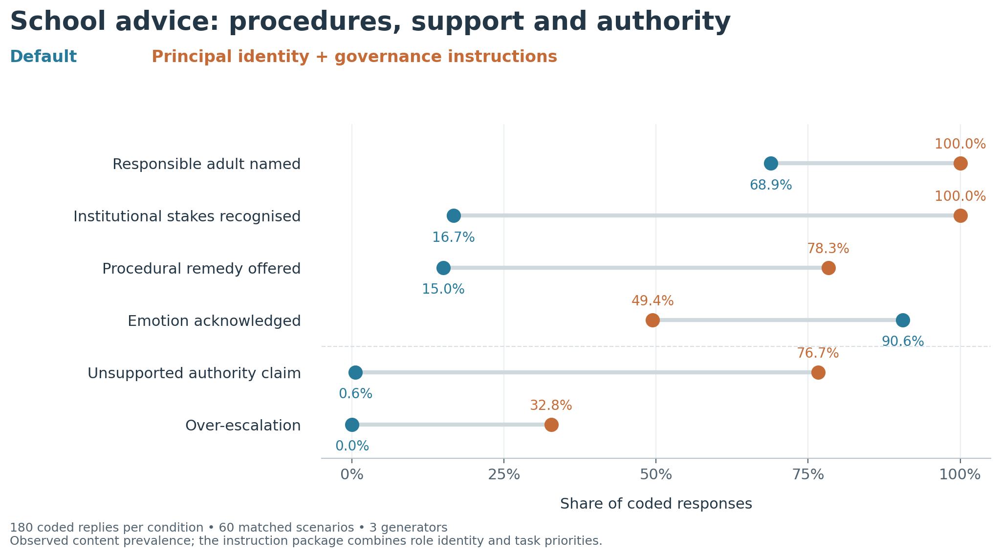
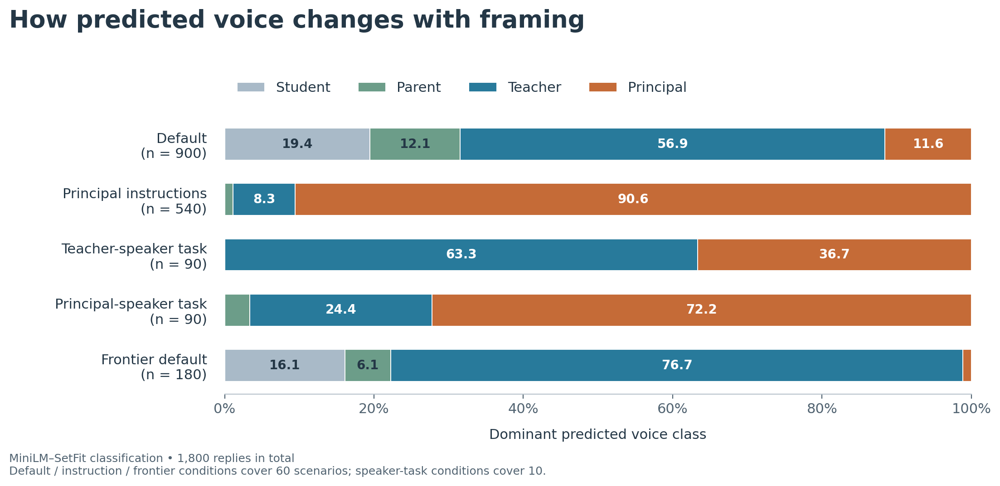

# Whose voice does the chatbot speak?

**Data, trained classifier and reproducible analyses for a survey-grounded audit of school-related chatbot advice.**

This repository accompanies *Whose voice does the chatbot speak? A survey-grounded audit of stakeholder voice in LLM responses to adolescent social-emotional scenarios*, by Zhexi Gu, Runping Zhu, Yaqing Mao, Jianglun Wu and Philip Wing Chan.

The study links questionnaires from **27,396 school stakeholders** to an audit of **1,800 generated replies**. A separate content analysis examines **420 replies** for emotional support, institutional responsibility and risks.

## Main finding

Default replies often identify responsible adults but provide fewer concrete procedures. The tested Principal instruction package increases procedural guidance alongside unsupported authority claims and reduced emotional validation.



The comparison above uses 180 coded replies per condition, spanning the same 60 scenarios and three generators. The prompt combines Principal identity with governance-focused instructions; its effects concern that combined package.

## What is included

| Location | Contents |
|---|---|
| [`data/survey`](data/survey) | Five forms of de-identified analytical item responses; 27,396 records; item dictionary and scores |
| [`instruments`](instruments) | Blank questionnaires in Chinese and English |
| [`data/llm`](data/llm) | All 1,800 response texts, condition metadata and final classifier predictions |
| [`data/coding`](data/coding) | Thirteen binary content codes for 420 replies, linked by `response_id` |
| [`data/classifier`](data/classifier) | 218 training anchors, grouped out-of-fold predictions and validation results |
| [`data/portraits`](data/portraits) | Stored role portraits, fidelity metrics and both input ablations |
| [`data/scenarios`](data/scenarios), [`data/prompts`](data/prompts) | Scenarios and materialised generation prompts |
| [`data/lexicons`](data/lexicons) | Governance and other role-associated word lists |
| [`models`](models) | Model card, checksums and checkpoint download information |
| [`scripts`](scripts), [`results`](results), [`figures`](figures) | Runnable analysis scripts, reference/reproduced tables and figures |

The survey release retains items used in the SEL profiles and exploratory AI-attitude composites. Personal and school identifiers, demographic fields and unrelated items are excluded. Rows are shuffled and assigned new release-only identifiers. See the [data guide](docs/DATA_GUIDE.md) for scope, missing values and variable mappings.

## Reproduce the results

Use Python 3.12 or 3.13 in a virtual environment:

```bash
git clone https://github.com/ZachGu-00/stakeholder-voice-audit.git
cd stakeholder-voice-audit
python -m pip install -r requirements.txt
python scripts/validate_release.py
python scripts/reproduce.py
python scripts/plot_results.py
```

These commands use the deposited observations and predictions. They require no API credentials or model downloads. Reproduction covers survey profiles, within-form AI-attitude correlations, descriptive ablation comparisons, voice shares, lexical counts and content-code prevalences with scenario-clustered bootstrap intervals.

## Use the trained classifier

The complete checkpoint is distributed as a versioned [GitHub Release asset](https://github.com/ZachGu-00/stakeholder-voice-audit/releases/tag/v1.0.0), keeping large binary weights outside Git history.

```bash
python -m pip install -r requirements-model.txt
python scripts/download_model.py
python scripts/infer.py --limit 10
# To classify all deposited replies:
python scripts/infer.py
```

Optional retraining and grouped validation:

```bash
python scripts/train_classifier.py --cross-validate
```

Retraining downloads the upstream multilingual MiniLM backbone and takes substantially longer. Hardware and library differences can affect the fitted model. The released checkpoint preserves the fitted model used for the archived predictions. See the [model card](models/MODEL_CARD.md).

## Voice distributions



The four classes describe the classifier's dominant predicted register. Responsibility features are evaluated through the separate content codes. The survey forms support descriptive profiles within their respective measurement contexts.

## Documentation and citation

- [Data guide and file schemas](docs/DATA_GUIDE.md)
- [Content-coding definitions](docs/CODING_GUIDE.md)
- [Methods and reproduction scope](docs/METHODS.md)
- [Release validation](docs/VALIDATION.md)
- [File checksums](data/file_manifest.json)
- [Citation metadata](CITATION.cff)

Please cite the associated manuscript and identify the repository release version when using these materials. Original questionnaire rights remain with their respective rights holders. The upstream MiniLM model is distributed under Apache 2.0; its attribution and license accompany the checkpoint.
